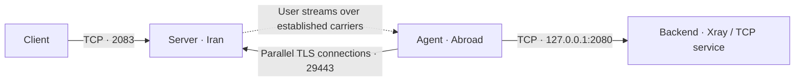

<div align="center">


# Parallel Tunnel

**تانل معکوس TCP با اتصال‌های موازی و رمزنگاری TLS**

[](go.mod)
[](#security)
[](https://github.com/hashicorp/yamux)

[نصب](#installation) · [راه‌اندازی](#quick-start) · [ظرفیت](#capacity) · [پارامترها](#options) · [عیب‌یابی](#troubleshooting)

</div>

---

Parallel Tunnel یک تانل معکوس برای انتقال سرویس‌های TCP میان دو سرور است. Agent در سمت خروجی چند اتصال مستقل به سرور ورودی باز می‌کند و هر اتصال، چندین جریان کاربر را با Yamux حمل می‌کند.

از این ساختار می‌توان برای رساندن ترافیک به یک سرویس TCP ثابت، از جمله اینباند Xray یا پنل سنایی، استفاده کرد. هر نمونهٔ برنامه یک ورودی و یک مقصد دارد.

## بررسی فشار و تشخیص قطع اتصال

این شاخه آمار سبک در لاگ و یک حالت اختیاری برای دوری از اتصال‌های معطل در زمان تخصیص جریان جدید دارد. توضیح پرچم‌ها، محدودیت اندازه‌گیری و روند عرضه در [راهنمای تشخیص فشار](DIAGNOSTICS.md) آمده است.

## قابلیت‌ها

| قابلیت | رفتار |
|---|---|
| اتصال معکوس | Agent سمت خروجی به Server سمت ورودی متصل می‌شود |
| حامل‌های موازی | تعداد اتصال‌های مستقل TCP/TLS قابل تنظیم است |
| چندجریانی | هر حامل چند جریان مستقل Yamux را حمل می‌کند |
| رمزنگاری | TLS 1.3 با بررسی گواهی سرور |
| احراز هویت Agent | توکن تصادفی ۳۲ بایتی مشترک |
| انتخاب حامل | کمترین تعداد جریان فعال، با گردش بین حامل‌های هم‌بار |
| بازیابی حامل | اتصال مجدد با تأخیر افزایشی و تصادفی پس از قطع |
| صف محدود | انتظار کوتاه برای آزادشدن ظرفیت یا رسیدن حامل جدید |
| نیم‌بستن TCP | پشتیبانی از پروتکل‌هایی که پایان درخواست را با EOF مشخص می‌کنند |

<a id="architecture"></a>

## معماری



Agent آغازکنندهٔ اتصال بین دو سرور است. کاربر به پورت عمومی Server وصل می‌شود و دادهٔ او روی یکی از حامل‌های برقرارشده به Agent می‌رسد. سپس Agent به مقصد تعیین‌شده در `-target` متصل می‌شود.

وقتی یک حامل قطع شود، جریان‌های روی همان حامل پایان می‌یابند. Agent حامل را دوباره برقرار می‌کند و حامل‌های سالم به انتقال جریان‌های خود ادامه می‌دهند.

<a id="installation"></a>

## نصب

روی هر دو سرور لینوکس، با دسترسی root اجرا کنید.

```bash
bash <(curl -fsSL https://raw.githubusercontent.com/ALIsalemi1/Parallel-Tunnel/main/install.sh)
```

نصب‌کننده معماری `amd64` یا `arm64` را تشخیص می‌دهد، ابزار Go را با بررسی SHA-256 دریافت می‌کند و برنامه را از سورس نسخهٔ مشخص‌شده می‌سازد. فایل اجرایی در `/usr/local/bin/parallel-tunnel` قرار می‌گیرد. مراحل بعد، گواهی، توکن و اجرای دو سمت را تنظیم می‌کنند.

پیش‌نیازها شامل Bash، `curl`، `tar`، `sha256sum` و `install` هستند. برای تولید گواهی و توکن، OpenSSL لازم است. نصب به دسترسی اینترنت برای دریافت Go، سورس و وابستگی‌ها نیاز دارد.

<a id="quick-start"></a>

## راه‌اندازی سریع

### نقشهٔ پورت‌ها

| نقش | آدرس نمونه | کاربرد |
|---|---|---|
| پورت کاربران روی ایران | `0.0.0.0:2083` | آدرسی که کلاینت به آن وصل می‌شود |
| پورت حامل روی ایران | `0.0.0.0:29443` | مقصد اتصال‌های TLS ایجادشده توسط Agent |
| سرویس مقصد روی خارج | `127.0.0.1:2080` | اینباند Xray یا سرویس TCP |

پورت‌ها نمونه هستند و باید روی میزبان آزاد باشند. در فایروال، پورت کاربران را برای کلاینت‌ها و پورت حامل را برای سرور Agent قابل دسترسی کنید.

### ساخت گواهی و توکن روی ایران

به‌جای `tunnel.example.com` دامنه‌ای را قرار دهید که به IP سرور ایران اشاره می‌کند.

```bash
install -d -m 700 /etc/parallel-tunnel
cd /etc/parallel-tunnel
umask 077

openssl rand -hex 32 > tunnel.token
openssl req -x509 -newkey ed25519 -nodes -days 365 \
  -subj '/CN=tunnel.example.com' \
  -addext 'subjectAltName=DNS:tunnel.example.com' \
  -keyout tunnel.key -out tunnel.crt
```

برای اتصال مستقیم با IP، مقدار SAN را به شکل `subjectAltName=IP:YOUR_IRAN_IP` بنویسید و همان IP را در `-tunnel` سمت Agent استفاده کنید.

فایل‌های `tunnel.crt` و `tunnel.token` را از طریق SSH یا مسیر امن به `/etc/parallel-tunnel` روی خارج منتقل کنید. مجوز دایرکتوری را `700` و فایل‌ها را `600` قرار دهید. کلید خصوصی `tunnel.key` روی ایران نگهداری می‌شود.

### اجرای Server روی ایران

```bash
parallel-tunnel server \
  -tunnel 0.0.0.0:29443 \
  -listen 0.0.0.0:2083 \
  -cert /etc/parallel-tunnel/tunnel.crt \
  -key /etc/parallel-tunnel/tunnel.key \
  -token-file /etc/parallel-tunnel/tunnel.token \
  -carriers 16 \
  -streams 32
```

### اجرای Agent روی خارج

سرویس مقصد باید روی `127.0.0.1:2080` فعال باشد.

```bash
parallel-tunnel agent \
  -tunnel tunnel.example.com:29443 \
  -target 127.0.0.1:2080 \
  -ca /etc/parallel-tunnel/tunnel.crt \
  -token-file /etc/parallel-tunnel/tunnel.token \
  -carriers 16 \
  -streams 32
```

پس از برقراری حامل‌ها، پیام `carrier up` ثبت می‌شود. در کانفیگ کلاینت، آدرس را روی IP یا دامنهٔ ایران و پورت را روی `2083` بگذارید. UUID، نوع انتقال، TLS، SNI و سایر تنظیمات باید با سرویس مقصد مطابقت داشته باشند.

فرمان‌های بالا در foreground اجرا می‌شوند. برای اجرای دائمی، آن‌ها را با مسیرهای مطلق در واحد جداگانهٔ systemd قرار دهید. نصب‌کننده فایل اجرایی را نصب می‌کند و ایجاد سرویس به تنظیمات خود میزبان وابسته است.

<a id="capacity"></a>

## تنظیم ظرفیت

`carrier` یک اتصال مستقل TCP/TLS است. `stream` یک جریان کاربر روی آن اتصال است.

**ظرفیت اسمی برابر تعداد حامل‌های برقرارشده ضرب‌در سقف جریان هر حامل است.**

| حامل‌های برقرارشده | جریان در هر حامل | ظرفیت اسمی |
|---:|---:|---:|
| ۱۶ | ۳۲ | ۵۱۲ |
| ۶۴ | ۳۲ | ۲٬۰۴۸ |
| ۶۴ | ۱۲۸ | ۸٬۱۹۲ |
| ۱۲۸ | ۱۲۸ | ۱۶٬۳۸۴ |
| ۳۲۰ | ۱۲۸ | ۴۰٬۹۶۰ |

در سمت Server، `-carriers` حداکثر حامل‌های مجاز است. در سمت Agent، تعداد حامل‌هایی است که باید برقرار شوند. مقدار Server باید تعداد اتصال‌های Agent را پوشش دهد و `-streams` در هر دو سمت یکسان باشد.

ظرفیت واقعی به RAM، CPU، پهنای باند، تأخیر، تعداد فایل‌دسکریپت‌های مجاز و پورت‌های مبدأ بستگی دارد. با قطع حامل‌ها ظرفیت در دسترس کاهش می‌یابد. بازهٔ پورت مبدأ Agent نیز تعداد اتصال‌های TCP به یک مقصد ثابت را محدود می‌کند.

در صورت نبود حامل آزاد، برنامه تا سه ثانیه منتظر تغییر ظرفیت می‌ماند. تعداد کل اتصال‌های ورودی پذیرفته‌شده نیز به حاصل‌ضرب مقادیر `-carriers` و `-streams` سمت Server به‌علاوهٔ ۱۲۸ محدود است. عبور از این سقف یا پایان مهلت انتظار باعث بسته‌شدن اتصال جدید می‌شود.

### محدودهٔ تست ظرفیت

تست مخزن، ۴۰٬۹۶۰ جریان هم‌زمان Yamux را در یک فرایند و با `net.Pipe` باز می‌کند و ظرفیت ساختار pool و نشست‌ها را بررسی می‌کند. ظرفیت سرتاسری TLS، سوکت‌های واقعی و عملکرد شبکه باید روی سرورهای مقصد زیر بار اندازه‌گیری شود.

<a id="options"></a>

## پارامترهای خط فرمان

| پارامتر | سمت | پیش‌فرض | کاربرد |
|---|---|---|---|
| `-tunnel` | هر دو | الزامی | آدرس گوش‌دادن Server یا آدرس اتصال Agent |
| `-token-file` | هر دو | الزامی | فایل توکن مشترک با ۶۴ نویسهٔ hex |
| `-carriers` | Server | `16` | سقف حامل‌های احراز هویت‌شده، از ۱ تا ۳۲۰ |
| `-carriers` | Agent | `8` | تعداد اتصال‌های موازی، از ۱ تا ۳۲۰ |
| `-streams` | هر دو | `32` | سقف جریان هر حامل، از ۱ تا ۱۲۸ |
| `-ping-interval` | هر دو | `20s` | فاصلهٔ ارسال probe زنده‌بودن حامل |
| `-ping-timeout` | هر دو | `30s` | مهلت ping، نوشتن روی حامل و بازشدن جریان |
| `-listen` | Server | `127.0.0.1:1081` | ورودی اتصال‌های کاربران |
| `-cert` و `-key` | Server | الزامی | گواهی PEM و کلید خصوصی TLS |
| `-target` | Agent | الزامی | مقصد ثابت TCP در سمت خروجی |
| `-ca` | Agent | الزامی | فایل PEM گواهی مورد اعتماد یا CA |
| `-tls-name` | Agent | میزبان `-tunnel` | نام مورد بررسی در گواهی TLS |

```bash
parallel-tunnel server -help
parallel-tunnel agent -help
```

<a id="security"></a>

## امنیت و رفتار اتصال

- حامل‌ها با TLS 1.3 رمزنگاری می‌شوند. Agent گواهی را با فایل `-ca` و نام میزبان بررسی می‌کند.
- Server توکن مشترک را پس از handshake TLS بررسی می‌کند. توکن باید ۳۲ بایت تصادفی به شکل ۶۴ نویسهٔ hex باشد.
- احراز هویت تانل مربوط به Agent است. سرویس مقصد باید احراز هویت کاربران خود را انجام دهد.
- پس از قطع حامل، Agent با تأخیر افزایشی و jitter دوباره متصل می‌شود. شروع مجدد جریان‌های روی حامل قطع‌شده به کلاینت وابسته است.
- انتقال TCP و یک مقصد ثابت برای هر نمونه پشتیبانی می‌شود. انتقال UDP، جابه‌جایی جریان فعال به حامل دیگر و تنظیم ظرفیت بر اساس منابع در این نسخه پیاده‌سازی نشده است.

<a id="troubleshooting"></a>

## عیب‌یابی

| نشانه | موارد قابل بررسی |
|---|---|
| پیام `carrier up` ظاهر نمی‌شود | آدرس و پورت حامل، فایروال، توکن و اعتبار گواهی |
| خطای نام گواهی TLS | تطابق SAN با میزبان `-tunnel` یا مقدار `-tls-name` |
| حامل برقرار است اما ترافیک عبور نمی‌کند | فعال‌بودن `-target` و تنظیمات پروتکل کلاینت |
| اتصال جدید زیر بار بسته می‌شود | ظرفیت حامل‌ها، سقف جریان‌ها، صف انتظار و منابع میزبان |
| تأخیر هنگام انتقال حجیم بالا می‌رود | صف TCP، افت بسته، توزیع ترافیک بین حامل‌ها و CPU Steal |
| خطای `too many open files` | محدودیت فایل‌دسکریپت‌های فرایند و واحد systemd |

رویدادهای حامل و خطاهای اتصال به مقصد در stderr ثبت می‌شوند. هنگام اجرا با systemd، نام واحد خود را در فرمان زیر جایگزین کنید.

```bash
journalctl -u YOUR_SERVICE_NAME -n 100 --no-pager
ss -s
free -h
vmstat 1 5
```

## ساخت و بررسی سورس

Go نسخهٔ 1.25 یا جدیدتر لازم است.

```bash
git clone https://github.com/ALIsalemi1/Parallel-Tunnel.git
cd Parallel-Tunnel
go test ./...
go vet ./...
CGO_ENABLED=0 go build -trimpath -o parallel-tunnel .
```

تست‌ها احراز هویت، قطع حامل، ادامهٔ جریان روی حامل سالم، انتقال به backend واقعی، نیم‌بستن TCP و ظرفیت pool را پوشش می‌دهند.

## گزارش مشکل و وابستگی‌ها

در گزارش مشکل، معماری سیستم، فرمان اجرا با حذف اطلاعات محرمانه، تعداد حامل‌ها و جریان‌ها، مصرف منابع و لاگ زمان اختلال را بنویسید. [ثبت Issue](https://github.com/ALIsalemi1/Parallel-Tunnel/issues)

چندجریانی برنامه با Yamux v0.1.2 پیاده‌سازی شده است. متن مجوز این وابستگی در مخزن قرار دارد. [Yamux](https://github.com/hashicorp/yamux/tree/v0.1.2) · [مجوز Yamux](YAMUX-LICENSE.txt)
